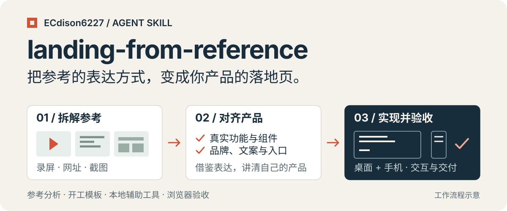

<p align="center">
  
</p>

**参考有了，把你自己的 Landing 做出来。**

`landing-from-reference` 是一个可复用的 Agent 技能：让 Agent 理解参考网站的版式、卡片和交互，再结合你的产品代码、真实功能与品牌，制作产品内首页或独立展示页。

[快速开始](#快速开始) · [工作流程](#工作流程) · [配套工具](#配套工具) · [文件导航](#文件导航)

## 它能帮你做什么

- **从参考里提炼方法。** 拆解录屏、网址或截图中的信息节奏、布局和交互，确定哪些适合你的产品。
- **让页面讲清真实能力。** 阅读现有代码和组件，把参考段落映射到产品功能，整理文案、演示和按钮入口。
- **把实现和验收做完整。** 检查桌面与手机布局，实际点击入口、返回、演示控件和表单，再按约定交付源码、独立 HTML 或部署结果。

如果你有产品源码和一个喜欢的参考站，可以从下面的示例直接开始。只有产品说明时，也可以在[开工模板](./references/brief-template.md)中写明现状与可实现范围。

## 快速开始

### 1. 安装技能

把整个仓库放进 Agent 的技能目录，文件夹名保持 `landing-from-reference`。Codex 示例：

```bash
mkdir -p "${CODEX_HOME:-$HOME/.codex}/skills"
git clone https://github.com/ECdison6227/landing-from-reference.git \
  "${CODEX_HOME:-$HOME/.codex}/skills/landing-from-reference"
```

也可以[下载 ZIP](https://github.com/ECdison6227/landing-from-reference/archive/refs/heads/main.zip)，解压到所用 Agent 的技能目录。技能正文可以直接使用；抽帧和二维码处理的依赖按需安装。

### 2. 提供产品与参考

复制下面的请求，替换产品名和材料路径：

```text
请使用 landing-from-reference 技能，为我的产品重设计 Landing 页面。

产品名：你的产品名
产品定位：一句话说明目标用户和核心用途
源码：本机项目目录，或附上的 ZIP
参考：录屏文件路径、公开网址或截图
页面性质：产品内首页，“开始使用”进入产品，产品内可以返回首页
品牌：沿用产品的字体和主色，可重新安排版式与动效
报名：不需要
交付：先给我本地预览，由我决定是否部署
语言：中文
```

需要独立展示页、报名、二维码或指定部署目标时，补充[完整开工模板](./references/brief-template.md)。支持技能提及的工具可用 `$landing-from-reference`；支持斜杠命令的工具可用 `/landing-from-reference`，具体取决于宿主工具。

## 工作流程

1. **确定范围。** 确认产品能力、参考材料、页面位置、按钮去向和交付形式。
2. **拆解参考。** 观察关键状态；录屏可先抽帧，再用[分析模板](./references/reference-analysis.md)记录版式、卡片、交互和移动端适配。
3. **理解产品。** 阅读真实功能、组件与数据模型，确定每一段要讲什么、用什么演示。
4. **实现页面。** 按品牌和约定范围落地，处理入口、返回、演示播放、表单与内容保留。
5. **验证交付。** 检查桌面和手机，运行与改动相称的构建及回归检查，给出实际预览地址或交付文件。

实现细节见[实现与验收](./references/implementation.md)；需要单文件 HTML、表单或部署时，再读[交付说明](./references/delivery.md)。

## 配套工具

两个工具都在本机处理材料。视频通过临时的 `127.0.0.1` 服务供浏览器解码；二维码工具读取本地图片并校验输出。

<details>
<summary><strong>录屏抽帧：关键画面、时间索引与总览图</strong></summary>

需要 Node.js 22+。在技能目录中安装依赖并执行：

```bash
cd "${CODEX_HOME:-$HOME/.codex}/skills/landing-from-reference"
npm ci
npx playwright install chromium
node scripts/frames.mjs ./reference.mp4 ./output/frames 2 --browser chromium
```

示例每隔 2 秒采样一次，输出：

```text
output/frames/
├── f_0000_0.0s.jpg      # 逐帧 JPEG
├── ...
├── contact-sheet.jpg   # 带时间标签的总览图
└── frames.json         # 视频信息与帧索引
```

可用 `--browser chrome` 或 `--browser msedge` 选择本机浏览器；`--from /path/to/package.json` 可复用已有 Playwright。默认最多 240 帧，长录屏可调大采样间隔或设置 `--max-frames`。

</details>

<details>
<summary><strong>二维码处理：裁切、保留白边并校验编码内容</strong></summary>

需要 Python 3.10+。在技能目录中创建独立虚拟环境：

```bash
python3 -m venv .venv
.venv/bin/python -m pip install -r requirements.txt
.venv/bin/python scripts/qr.py ./contact.png ./output/qr.png
```

图片中有多个二维码时，指定目标区域。四个数字是相对于图片宽高的「左、上、右、下」边界：

```bash
.venv/bin/python scripts/qr.py ./contact.png ./output/qr.png 0.1 0.2 0.9 0.8
```

可用 `--size 520` 调整尺寸，或用 `--monochrome` 生成黑白图。只有输出与输入区域的二维码内容一致时才保存；默认不打印二维码中的链接。

Windows PowerShell 将虚拟环境解释器替换为 `.\.venv\Scripts\python.exe`，例如：

```powershell
.\.venv\Scripts\python.exe -m pip install -r requirements.txt
.\.venv\Scripts\python.exe scripts/qr.py .\contact.png .\output\qr.png
```

解码一致只说明编码内容相同；目标链接是否过期、群是否已满，需要在最终页面实际扫码确认。

</details>

完整参数、格式限制和环境说明见[工具说明](./references/tools.md)。

## 文件导航

| 你要做什么 | 从这里开始 |
| --- | --- |
| 让 Agent 执行整个流程 | [SKILL.md](./SKILL.md) |
| 准备产品和参考材料 | [开工模板](./references/brief-template.md) |
| 拆解参考并映射产品功能 | [分析模板](./references/reference-analysis.md) |
| 处理组件、交互与验收 | [实现与验收](./references/implementation.md) |
| 交付独立 HTML、表单或部署 | [交付说明](./references/delivery.md) |
| 排查端口、平台与协作问题 | [实践经验](./references/lessons.md) |
| 使用本地媒体辅助工具 | [抽帧脚本](./scripts/frames.mjs) · [二维码脚本](./scripts/qr.py) |

## 工具验证

在安装对应依赖后运行仓库自带测试。测试使用临时生成的视频与二维码：

```bash
npm test
.venv/bin/python -m pip install -r requirements-dev.txt
.venv/bin/python -m unittest discover -s tests -p "test_*.py"
```

Windows 使用 `.\.venv\Scripts\python.exe` 替换 `.venv/bin/python`。

## 使用与交付约定

- 页面依据产品真实能力编写；统计数字、导出格式和隐私表述需要代码或产品说明支持。
- 参考材料用于理解结构和表达方式。静态截图不能证明完整交互，关键动效需要结合录屏或网页观察。
- “先预览”交付本地可查看结果；上传仓库或部署按本次任务的授权范围执行。
- 仓库提供工作流、模板和辅助脚本。具体页面由 Agent 根据产品实现，通用站点生成器与自动部署程序需另外实现。
- 包内不包含产品源码、私人录屏、真实群二维码、服务器账号或报名数据。实际材料由使用者提供。

由 [ECdison6227](https://github.com/ECdison6227) 维护。
